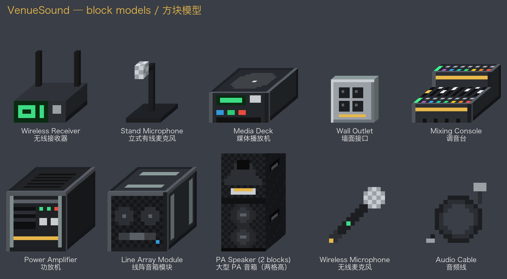

<p align="center">
  
</p>

<p align="center">
  <a href="https://github.com/TonyD365/venue-sound/actions/workflows/ci.yml"></a>
  <a href="https://github.com/TonyD365/venue-sound/actions/workflows/security.yml"></a>
  
  
  
  <a href="LICENSE"></a>
</p>

<p align="center"><b>A real venue sound system for Minecraft.</b><br>
Wireless and wired microphones, a media player, wall outlets, a mixing console, power amplifiers and PA speakers,<br>
all cabled together with wires you can see — built on Simple Voice Chat.</p>

<p align="center"><a href="#中文说明">中文说明 ↓</a></p>

---

## The signal chain

It works the way a theatre does: every sound starts at a source, runs through cables to the console, then to the amplifiers and out of the speakers.

```
🎤 Wireless Mic ─radio─▶ 📡 Receiver ─┐
🎙️ Stand Mic ─────────────────────────┤──cable──▶ 🔌 Outlets ──▶ 🎚️ Mixing Console ──▶ 🔌 ──▶ 🔊 Amplifier ──▶ 🔈 PA Speakers
💿 Media Deck ────────────────────────┘
```

<p align="center"></p>

| Device | What it does | How to use it |
|---|---|---|
| 🎤 **Wireless Microphone** | Transmits your voice while you hold it | Right-click: channel 1–8 · Sneak + right-click: mute |
| 📡 **Wireless Receiver** | Picks up wireless mics on its channel within 128 blocks | Right-click: channel |
| 🎙️ **Stand Microphone** | Wired mic on a stand: picks up anyone talking within 3 blocks | Cable it to a console |
| 💿 **Media Deck** | Plays `.mp3` / `.wav` files from the server's `venuesound_media` folder into the cables | Right-click: pick a track, play, stop, loop |
| 🔌 **Wall Outlet** | A patch point on the wall or floor: chain outlets to run cables further, or split one signal into up to 8 | Place on a wall |
| 🎚️ **Mixing Console** | 8 inputs, each with a fader (0–200 %), mute and a label showing what is plugged in, plus a master fader | Right-click: open the console |
| 🔊 **Power Amplifier** | Sits between the console and the speakers | Right-click: output level · Sneak + right-click (empty hand): power |
| 🔈 **PA Speaker** | Two-block-tall cabinet: two woofers and a horn | Right-click: coverage 16–128 blocks |
| 🔈 **Line Array Module** | Compact speaker to stack or hang | Right-click: coverage |
| 〰️ **Audio Cable** | Click where the signal comes **from**, then where it goes **to**. Each cable is drawn in the world and reaches 32 blocks | Sneak-click a device: unplug its cables |

**What can be cabled to what**

| From | To |
|---|---|
| Receiver, Stand Mic, Media Deck | Outlet, Console |
| Outlet | Outlet, Console, Amplifier, Speaker |
| Console | Outlet, Amplifier, Speaker (powered speakers) |
| Amplifier | Outlet, Speaker |

Every player can also set the volume of all PA speakers under **VenueSound PA** in Simple Voice Chat's volume settings.

## Quick start

1. Install **Fabric API** and **Simple Voice Chat**, then put the VenueSound jar in `mods`.
2. Place a **Mixing Console**, a **Power Amplifier** and two **PA Speakers**, one on each side of the stage.
3. With the **Audio Cable**: console → amplifier, then amplifier → each speaker.
4. Place a **Wireless Receiver** and cable it receiver → console (it lands on the first free input).
5. Hold a **Wireless Microphone** on the same channel as the receiver and talk. Open the console to mix.

For music, put `.mp3` or `.wav` files in `venuesound_media/` (next to `mods/`; on a server, in the server folder), cable a **Media Deck** to the console and press Play.

## Good to know

- **Screens from other mods** (for example WATERFrAMES) play their sound on each player's own computer, so it cannot be cabled into the console. Use the Media Deck for the soundtrack instead.
- Tracks longer than 4 minutes are cut at 4 minutes.
- Everything runs on the server; players only need the mod to see the blocks and cables.

## Building

You need Java 17.

```bash
./gradlew build
```

The jar is written to `build/libs/`. Textures and the images in `docs/` are generated by the scripts in `tools/`.

## Contributing

Bug reports, ideas and pull requests are welcome; see [CONTRIBUTING.md](CONTRIBUTING.md). A bot account helps on pull requests and issues (see the bot section there), and security problems go through [SECURITY.md](SECURITY.md).

---

## 中文说明

**VenueSound 场馆音响**：一套跟真实剧场一样的扩声系统。无线麦、立式有线麦、媒体播放机、墙面接口、调音台、功放机、PA 大音响，全部用**看得见的音频线**连起来。基于 Simple Voice Chat。

| 设备 | 作用 | 用法 |
|---|---|---|
| 🎤 无线麦克风 | 拿在手上说话即可发射 | 右键：切换通道 1–8 · 潜行 + 右键：静音 |
| 📡 无线接收器 | 接收 128 格内同通道的无线麦 | 右键：切换通道 |
| 🎙️ 立式有线麦克风 | 3 格内有人说话就会拾音 | 用线接到调音台 |
| 💿 媒体播放机 | 播放 `venuesound_media` 文件夹里的 mp3 / wav | 右键：选曲、播放、停止、循环 |
| 🔌 墙面接口 | 中转、延长、一分多（最多 8 路） | 贴在墙上 |
| 🎚️ 调音台 | 8 路推子（0–200%）、静音、每路显示接的是什么、总音量 | 右键打开 |
| 🔊 功放机 | 调音台和音箱之间 | 右键：输出档位 · 空手潜行 + 右键：电源 |
| 🔈 大型 PA 音箱 | 两格高，两个低音 + 一个号角 | 右键：覆盖范围 16–128 格 |
| 🔈 线阵音箱模块 | 小型音箱，可叠放或吊挂 | 右键：覆盖范围 |
| 〰️ 音频线 | 先点信号**来源**，再点信号**去向**；每根最长 32 格 | 潜行点击设备：拔线 |

**快速开始**：调音台 → 功放 → 两个 PA 音箱接好；接收器 → 调音台；拿起无线麦（通道和接收器一致）说话即可。放音乐：把 mp3 放进 `venuesound_media` 文件夹，媒体播放机接到调音台，点播放。

**注意**：WATERFrAMES 等屏幕模组的声音是在每个玩家自己电脑上播放的，接不进调音台，请用媒体播放机放配乐。

## License

[MIT](LICENSE)
