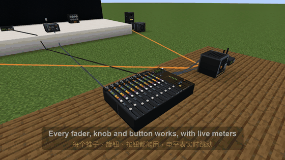
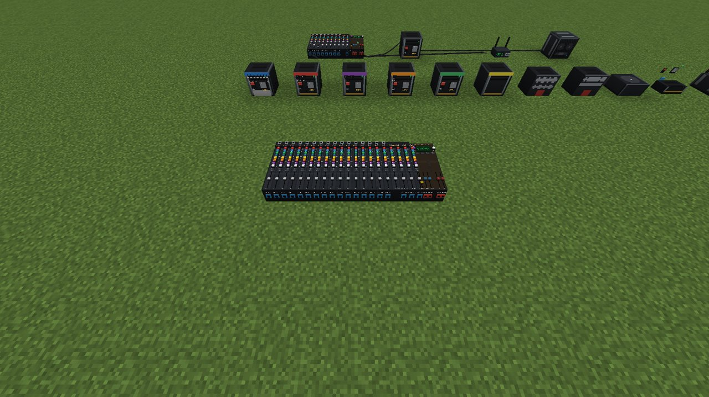
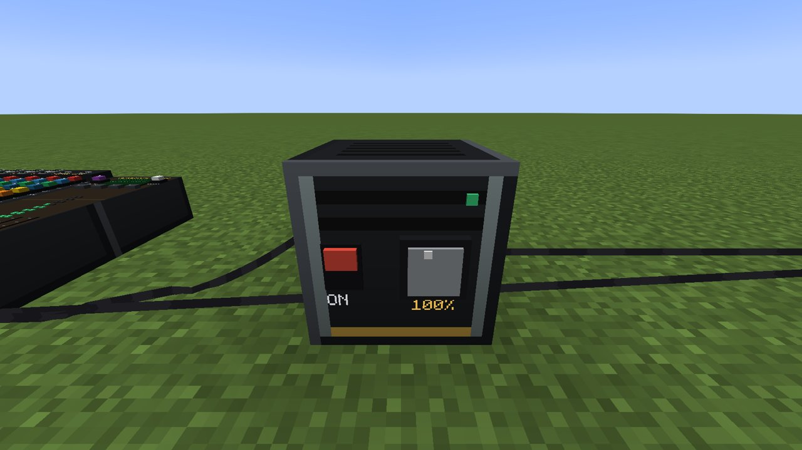
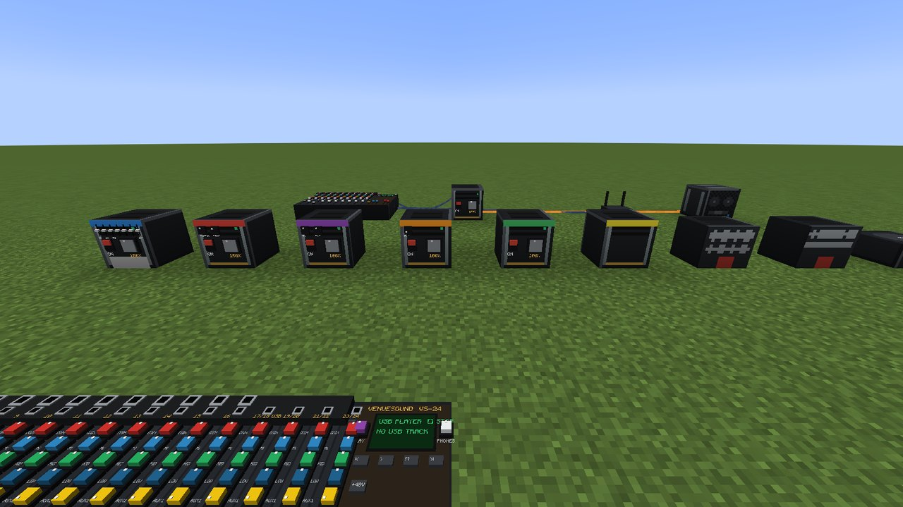
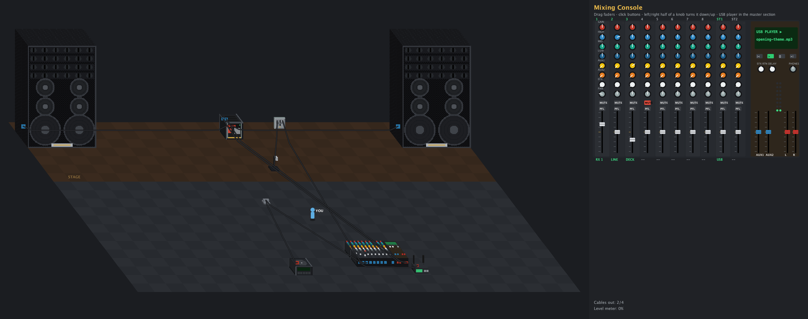

<p align="center">
  
</p>

<p align="center">
  <a href="https://github.com/TonyD365/venue-sound/releases/latest"></a>
  <a href="https://github.com/TonyD365/venue-sound/releases"></a>
  <a href="https://github.com/TonyD365/venue-sound/actions/workflows/ci.yml"></a>
  
  
  
  <a href="LICENSE"></a>
</p>

<p align="center">
  <a href="https://github.com/TonyD365/venue-sound/releases/latest"><b>⬇️ Download</b></a> ·
  <a href="https://tonyd365.github.io/venue-sound/">Website</a> ·
  <a href="docs/guide/README.md">User guide</a> ·
  <a href="#quick-start">Quick start</a> ·
  <a href="#the-devices">Devices</a> ·
  <a href="#faq">FAQ</a> ·
  <a href="CHANGELOG.md">What's new</a> ·
  <a href="README.zh-CN.md">中文</a> ·
  <a href="https://github.com/TonyD365/venue-sound/issues/new/choose">Report a problem</a>
</p>

**VenueSound puts a real concert sound system into Minecraft.** Sing into a wireless mic, and
your voice goes through a receiver, along cables you can see, into a mixing console with gain,
EQ, aux sends and effects, through a power amplifier and out of the PA speakers, heard by every
player from where they stand. Every knob, fader, switch and socket is used right on the model,
with a right-click or the mouse wheel. Built on [Simple Voice Chat](https://modrinth.com/plugin/simple-voice-chat).

<p align="center">
  <a href="https://tonyd365.github.io/venue-sound/#video"></a>
  <br><sub>Every fader, knob and button works, with live meters. <a href="https://tonyd365.github.io/venue-sound/#video"><b>▶ Watch the 50-second video</b></a> (with music and subtitles).</sub>
</p>

**Three steps:** 1. install Fabric API, Simple Voice Chat and VenueSound · 2. place a console, an
amplifier and two speakers and cable them up · 3. hold a wireless mic on the receiver's channel
and talk.

## Why VenueSound

Theatres, concerts and talent shows are some of the most popular things to build in Minecraft,
but the sound has always been the weak part: voice chat fades out a few blocks from the stage,
and nothing behaves like real audio equipment. VenueSound makes the sound system as real as the
building around it, so a show in Minecraft is run the way a real one is: patch the inputs, set
the gain, ride the faders, send monitors to the stage.

## The signal chain

```
🎤 Wireless / headset / lavalier mic ─radio─▶ 📡 Receiver ─┐
🎙️ Stand, gooseneck and choir mics ───────────────────────┤        🎛️ EQ · compressor · effects · crossover
💿 Media deck · 📺 Video capture ──────────────────────────┤             │
🔌 Stage box ══ multicore snake ═══════════════════════════┴──▶ 🎚️ Console ──▶ 🔊 Amplifier ──▶ 🔈 Speakers
                                                                      │ AUX ──▶ wedges · in-ear monitors
```

Signal only flows along cables you plug in, socket to socket, and every device is used directly
on its model. Full details: [signal chain guide](docs/guide/signal-chain.md).

## The devices

<p align="center"></p>

| Group | Devices |
|---|---|
| **Sources** | Wireless mic (16 channels), headset and lavalier mics you wear, stand, gooseneck podium and hanging choir mics, media deck (mp3/wav), video capture zone for WATERFrAMES screens |
| **Mixing** | VS-12 console (8 mono + 2 stereo, 3×2 blocks), VS-24 console (16 mono + 4 stereo, 5×2 blocks): gain, peak LED, HI/MID/LOW EQ, AUX 1/2, EFX, pan, mute, PFL, faders, USB player, meters |
| **Rack** | Power amplifier, graphic EQ, compressor/limiter, effects processor, crossover, power sequencer, rack cabinet |
| **Speakers** | Line array module, flown line array with truss point, PA cabinet, 4×6 concert stack, floor wedge, subwoofer, in-ear monitor transmitter and earpiece |
| **Cabling** | XLR mic cable, speaker cable, multicore snake, stage box (8/16 ch), wall outlet, DI box, cable clips, cable reel |

Every device: [device guide](docs/guide/devices.md).

<table>
  <tr>
    <td></td>
    <td></td>
  </tr>
  <tr>
    <td align="center"><sub>VS-24: twenty channel strips</sub></td>
    <td align="center"><sub>Power amplifier: power switch and level knob</sub></td>
  </tr>
  <tr>
    <td></td>
    <td></td>
  </tr>
  <tr>
    <td align="center"><sub>Rack gear and microphones</sub></td>
    <td align="center"><sub>Input (blue) and output (red) sockets on the console's rear, facing the stage</sub></td>
  </tr>
</table>

## Quick start

1. Install **Fabric Loader** for Minecraft 1.20.1 or 1.21.1, **Fabric API** and **Simple Voice Chat**, then
   put the [VenueSound jar](https://github.com/TonyD365/venue-sound/releases/latest) for your Minecraft version in `mods/`.
2. Place a **mixing console**, a **power amplifier** and two **PA speakers**.
3. With an **audio cable**: right-click the console's **MAIN L** socket, then the amplifier's
   **IN A**; **MAIN R** → **IN B**; amplifier **OUT 1** → left speaker's **INPUT**, **OUT 3** →
   right speaker's **INPUT**.
4. Place a **wireless receiver** and cable its **OUT** to the console's **IN 1**.
5. Hold a **wireless microphone** on the receiver's channel and talk. Push fader 1 up.

Step by step with pictures: [getting started](docs/guide/getting-started.md).

Every item: [item guide](docs/guide/items.md).

## The Workbench

Not in Minecraft right now? **VenueSound Workbench** is a small desktop app with the same
devices, controls and signal engine. Build a system, run cables, drag faders, and hear it: your
computer's microphone and music files go through the console and out of the speakers in stereo,
from where you stand.

<p align="center"></p>

```bash
java -jar venuesound-workbench.jar
```

Guide: [Workbench](docs/guide/workbench.md).

## FAQ

**Do other players need the mod?** Yes, on both client and server (they see the devices and
cables), together with Simple Voice Chat.

**Can screens from WATERFrAMES play through the speakers?** Their volume can: put them in a
video capture zone and their sound follows the console's faders and mutes and is loud near the
speakers. Their audio is played by each player's own computer outside Minecraft's sound engine,
so it can't come from the speakers' direction.

**A cable is refused with "would go through a wall".** Cables rest on low obstacles but can't
pass through walls. Run the cable along **cable clips** around the wall.

**I can't hear anything.** Check the chain in order: mic channel = receiver channel, receiver →
console input, that strip's fader and the MAIN faders up, mute off, amplifier on, speakers on,
you within the speakers' coverage. More: [troubleshooting](docs/guide/troubleshooting.md).

## Building

Java 17 and 21 (Gradle downloads them if missing). Details: [building](docs/guide/building.md).

```bash
./gradlew build            # the mod for every Minecraft version: versions/<version>/build/libs/
./gradlew :workbench:jar   # the Workbench: workbench/build/libs/
./gradlew :1.20.1:runClient -Pselftest=true   # places every device in a test world and saves screenshots
```

Textures and the images in `docs/` are generated by the scripts in `tools/`; `./gradlew :1.20.1:runClient -Pphotos=true` then `python3 tools/make_item_images.py` re-shoots every item for the guide; `./gradlew :1.20.1:runClient -Pfilm=true` then `python3 tools/make_video.py` re-films the demo video (music from `tools/make_music.py`). Contributions are
welcome: see [CONTRIBUTING.md](CONTRIBUTING.md).

## License

[MIT](LICENSE)
