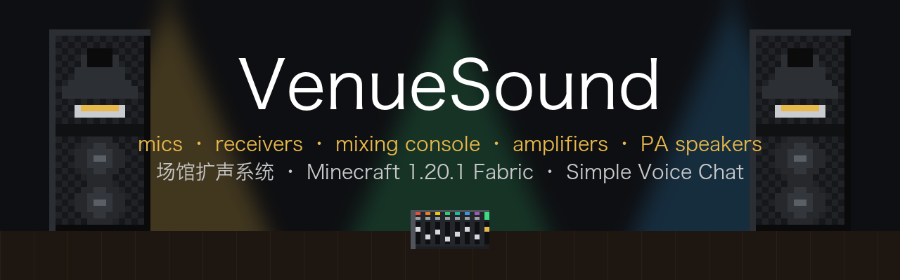
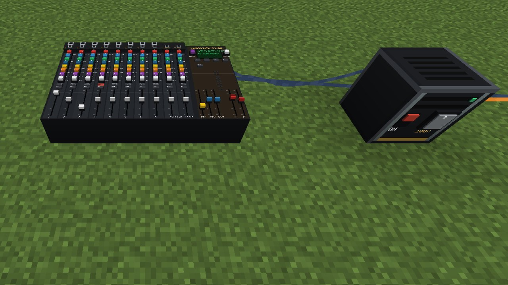
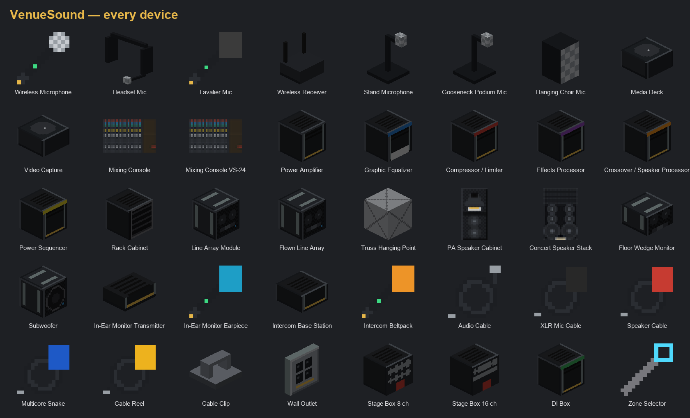

<p align="center">
  
</p>

<p align="center">
  <a href="https://github.com/TonyD365/venue-sound/releases/latest"></a>
  <a href="https://github.com/TonyD365/venue-sound/actions/workflows/ci.yml"></a>
  
  
  
</p>

<p align="center">
  <a href="https://github.com/TonyD365/venue-sound/releases/latest"><b>⬇️ 下载</b></a> ·
  <a href="https://tonyd365.github.io/venue-sound/">主页</a> ·
  <a href="docs/guide/README.md">使用指南（英文）</a> ·
  <a href="#快速上手">快速上手</a> ·
  <a href="#设备一览">设备</a> ·
  <a href="#常见问题">常见问题</a> ·
  <a href="README.md">English</a>
</p>

**VenueSound 把一套真实的演唱会扩声系统搬进了 Minecraft。** 对着无线麦说话，声音经过接收器，
沿着看得见的线进入调音台（增益、三段 EQ、AUX、效果器），再经过功放，从 PA 音箱里放出来；
每个玩家都按自己所在的位置听到它。所有旋钮、推子、开关、插孔都**直接在模型上操作**：右键或者滚轮。
基于 [Simple Voice Chat](https://modrinth.com/plugin/simple-voice-chat)。

<p align="center">
  
  <br><sub>游戏里的 VS-12 调音台：每个控件都能用。按住右键拖推子，或者对着它滚滚轮。</sub>
</p>

## 信号怎么走

```
🎤 无线麦 / 头戴麦 / 领夹麦 ─无线─▶ 📡 接收器 ─┐
🎙️ 立式麦、鹅颈讲台麦、合唱吊麦 ───────────────┤        🎛️ 均衡器 · 压缩器 · 效果器 · 分频器
💿 媒体播放机 · 📺 视频采集 ────────────────────┤             │
🔌 舞台接口箱 ══ 多芯线 ═══════════════════════┴──▶ 🎚️ 调音台 ──▶ 🔊 功放 ──▶ 🔈 音箱
                                                         │ AUX ──▶ 返听音箱 · 入耳监听
```

## 设备一览

<p align="center"></p>

每个设备的配方、接口和用法：[物品大全](docs/guide/items.zh-CN.md)（每个都配了图标和游戏内照片）。

| 类别 | 设备 |
|---|---|
| **信号源** | 无线麦（16 个通道）、可以戴在身上的头戴麦和领夹麦、立式麦、鹅颈讲台麦、合唱吊麦、媒体播放机（mp3/wav）、WATERFrAMES 屏幕的视频采集区 |
| **调音** | VS-12 调音台（8 单声道 + 2 立体声，3×2 格）、VS-24 调音台（16 + 4，5×2 格）：增益、过载灯、高中低 EQ、AUX 1/2、EFX、声像、静音、PFL、推子、USB 播放器、电平表 |
| **机柜** | 功放、图示均衡器、压缩/限幅器、效果器、分频器、电源时序器、机柜 |
| **音箱** | 线阵模块、吊挂线阵和桁架吊点、PA 音箱、4×6 演唱会音箱、地面返听、超低音、入耳监听发射器和耳机 |
| **线材** | 卡侬话筒线、音箱线、多芯线、舞台接口箱（8/16 路）、墙面接口、DI 盒、线卡、卷线盘 |

## 快速上手

1. 安装 Minecraft 1.20.1 的 **Fabric**，以及 **Fabric API**、**Simple Voice Chat**，再把
   [VenueSound](https://github.com/TonyD365/venue-sound/releases/latest) 放进 `mods/`。
2. 放一台**调音台**、一台**功放**、两台 **PA 音箱**。
3. 拿**音频线**：右键调音台的 **MAIN L**，再右键功放背面的 **IN A**；**MAIN R** → **IN B**；
   功放 **OUT 1** → 左音箱背面的 **INPUT**，**OUT 3** → 右音箱 **INPUT**。
4. 放一台**无线接收器**，把它背面的 **OUT** 接到调音台背面（朝舞台那一面）的 **IN 1**。
5. 手持**无线麦**（通道和接收器一致）说话，把第 1 路推子和红色主推子推上去。

每个物品的配方、摆放和接口：[物品大全](docs/guide/items.zh-CN.md)。

## 工作台（不进游戏也能测）

**VenueSound Workbench** 是一个桌面小程序，设备、控件和信号处理都和模组一样。可以摆设备、接线、
推推子，还能用电脑麦克风和音乐文件真的听到声音（立体声，按你站的位置）。

```bash
java -jar venuesound-workbench.jar
```

## 常见问题

**其他玩家要装模组吗？** 要，客户端和服务端都装，同时要有 Simple Voice Chat。

**WATERFrAMES 的屏幕声音能从音箱出来吗？** 音量可以：把屏幕放进视频采集区，声音就跟着调音台的推子和静音走，
离音箱近就大声。但它的声音是在每个玩家自己电脑上、在 Minecraft 声音系统之外播放的，所以没法真的从音箱方向传来。

**接线提示"会穿过墙"？** 线可以搭在矮的障碍物上，但不能穿墙。用**线卡**绕过去。

**没声音？** 按顺序检查：麦和接收器通道一致 → 接收器接到调音台 → 该路推子和主推子推上去、没静音 →
功放开机 → 音箱开机，而且你在音箱的覆盖范围内。

## 许可

[MIT](LICENSE)
