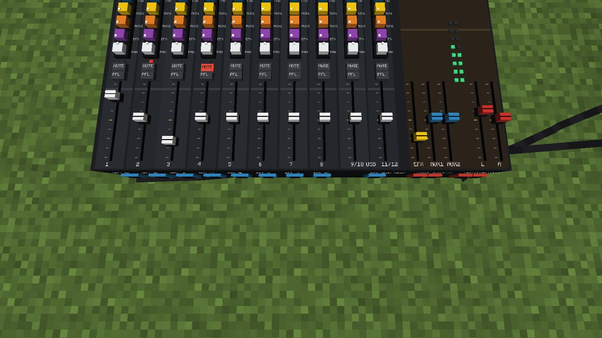

# The mixing console

## A channel strip (top to bottom)

| Control | Does |
|---|---|
| GAIN + PEAK LED | Input level; PEAK lights when the strip is driven hard |
| HI / MID / LOW | 3-band EQ, ±12 dB (8 kHz shelf, 1 kHz peak, 120 Hz shelf) |
| AUX 1 / AUX 2 | Sends to the AUX outputs (monitors) |
| EFX | Send to the effects unit (echo) |
| PAN | Between MAIN L and MAIN R |
| MUTE / PFL | Mute the strip / PFL light |
| Fader | Strip level; the gold mark is 0 dB |

## Master section

USB player (display, prev / play / stop / next) feeding ST1 · effects return and delay time ·
phones · level meters · AUX 1/2 masters (blue) · MAIN L/R (red).

## Sockets (front side)

IN 1–8 (VS-24: 1–16) and the stereo inputs under each strip; MAIN L, MAIN R, AUX 1, AUX 2 under
the master section.

## Using the controls

- **Faders**: hold right-click on the cap and move the crosshair, or scroll.
- **Knobs**: click the left half to turn down, right half to turn up, or scroll.
- **Buttons**: right-click.
