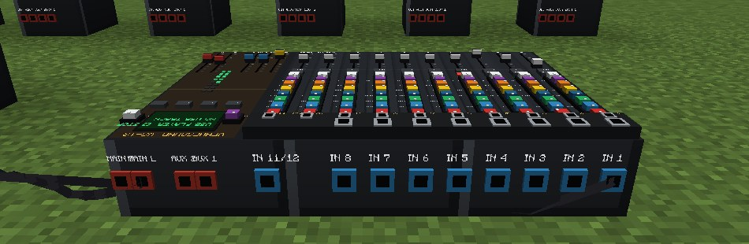

# The mixing console

## A channel strip (top to bottom)

| Control | Does |
|---|---|
| GAIN + PEAK LED | Input level; PEAK lights when the strip is driven hard |
| HI / MID / LOW | 3-band EQ, ±12 dB (8 kHz shelf, 1 kHz peak, 120 Hz shelf) |
| AUX 1 / AUX 2 | Sends to the AUX outputs (monitors) |
| EFX | Send to the effects unit (echo) |
| PAN | Between MAIN L and MAIN R |
| MUTE / PFL | Mute the strip / PFL light |
| Fader | Strip level; the gold mark is 0 dB |

## Master section

USB player (display, prev / play / stop / next) feeding ST1 · effects return and delay time ·
phones · level meters · AUX 1/2 masters (blue) · MAIN L/R (red).

## Sockets (rear side)

All sockets are on the rear side, facing the stage, so cables don't hang in front of you: IN 1–8
(VS-24: 1–16) and the stereo inputs behind each strip; MAIN L, MAIN R, AUX 1, AUX 2 behind the
master section.

## Using the controls

- **Faders**: hold right-click on the cap and move the crosshair, or scroll.
- **Knobs**: click the left half to turn down, right half to turn up, or scroll.
- **Buttons**: right-click.
- **+48V**: phantom power for condenser mics (gooseneck, choir), in the master section beside the
  USB player buttons. See [phantom power](cabling.md#phantom-power-48v).
- **Readout**: point the crosshair at any knob or fader to see its name and value below the
  crosshair, for example `CH 6  FADER  +0.0 dB`, `CH 2  HI  +4 dB` or `CH 3  PAN  L 40`. It works on
  the amplifier, the processors and the speakers' coverage knob too.

## Meters and PEAK LEDs

The two LED columns in the master section are the MAIN L and MAIN R output meters. They follow
the sound actually leaving the console, live: the first green LED lights at -42 dBFS, each
next one 6 dB higher, and the red top LED at -3 dBFS, close to clipping. They jump up at once and
fall back at about 20 dB per second.

Each strip's red **PEAK** LED lights for half a second when that channel's signal, after GAIN and
EQ, gets within about 1 dB of full scale. If it keeps lighting, turn that channel's GAIN down.

The meters are sent to players within 48 blocks of the console.
