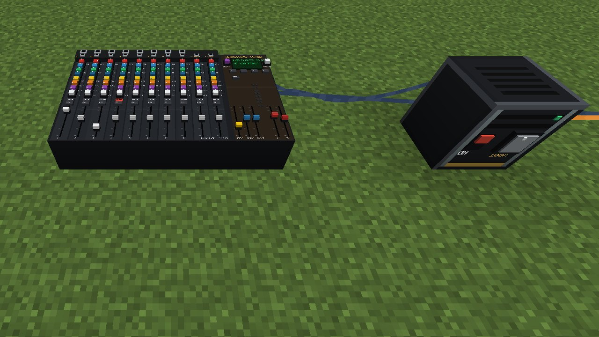

# Getting started

## Install

1. Install **Fabric Loader** for Minecraft **1.20.1**.
2. Put these in your `mods/` folder (on a server: on the server and every client):
   - [Fabric API](https://modrinth.com/mod/fabric-api)
   - [Simple Voice Chat](https://modrinth.com/plugin/simple-voice-chat)
   - [VenueSound](https://github.com/TonyD365/venue-sound/releases/latest)
3. Start the game and press **V** once to set up Simple Voice Chat's microphone.

Everything is in the **VenueSound** creative tab, and every device has a crafting recipe.

## Your first system

1. Place a **Mixing Console VS-12** (it needs 3×2 free blocks in front of and to the right of you).
2. Place a **Power Amplifier** and two **PA Speaker Cabinets** (one each side of the stage),
   speakers facing the audience.
3. Take an **audio cable**. Right-click a socket to plug in one end, then a socket on another
   device to plug in the other end:
   - console **MAIN L** → amplifier **IN A** (amplifier sockets are on its back)
   - console **MAIN R** → amplifier **IN B**
   - amplifier **OUT 1** → left speaker **INPUT** (on its back)
   - amplifier **OUT 3** → right speaker **INPUT**
4. Place a **Wireless Receiver**; cable its **OUT** (back) to console **IN 1** (on the console's rear side, facing the stage).
5. Take a **Wireless Microphone**. Its channel must match the receiver's (right-click the mic to
   change it, click the receiver's display or -/+ buttons to change the receiver).
6. Talk. On the console, push fader **1** and the red **L/R** master faders up.

Holding a cable you have plugged in at one end shows it running to your hand.

## Next

- Music: put `.mp3`/`.wav` files in `venuesound_media/` (next to `mods/`; on a server, in the
  server folder) and use a **Media Deck** or the console's built-in **USB player**.
- Monitors for performers: send **AUX 1** to **floor wedges** or an **in-ear monitor transmitter**.
- Tidy cables with **cable clips** and run many channels with a **stage box** and **snake**.
